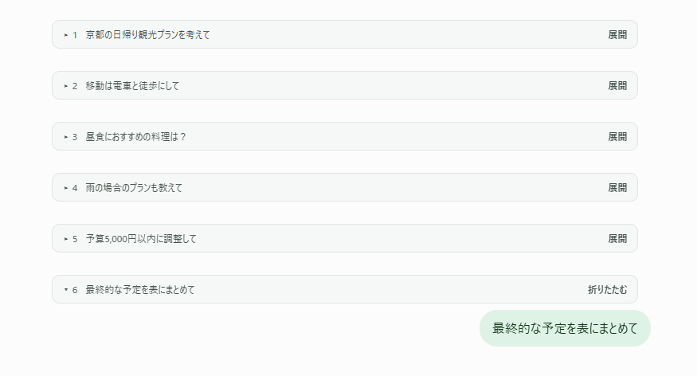

# ChatGPT Compressor

ブラウザ版ChatGPTの「ユーザーの質問＋ChatGPTの返答」を1ターンとして、過去の会話を折りたたむChrome拡張機能です。ビルドやAPIキーは不要です。

OpenAI公式の拡張機能ではありません。

## 動作画面

実際のChatGPT画面で、過去の会話を折りたたんだ例です。質問の冒頭を見ながら、必要な会話を展開できます。

## 導入

1. [最新リリース](https://github.com/Lumium64/ChatGPT-Compressor/releases/latest)の **Assets** から配布用ZIPをダウンロードし、展開します。
2. Chromeで `chrome://extensions` を開きます。
3. 「デベロッパーモード」をオンにします。
4. 「パッケージ化されていない拡張機能を読み込む」を押し、展開したフォルダのうち `manifest.json` が入っているフォルダを選びます。
5. ChatGPTのページを再読み込みします。

拡張機能メニューで **ChatGPT Compressor** を固定すると、設定画面を開きやすくなります。読み込み元のフォルダは削除せず保管してください。

## 使い方

- 初期設定では最新3ターンを表示し、それ以前を自動で折りたたみます。チャットの切り替えにも自動で追従します。
- 折りたたみバーには、表示順の番号と質問の冒頭が表示されます。「展開」「折りたたむ」で個別に切り替えられます。
- 最新のターンと返答待ちのターンは常に表示します。質問本文を取得できないターンにもバーを付けず、そのまま表示します。
- 設定画面で、表示する最近のターン数（1〜50）と有効・無効を変更できます。
- 「過去を折りたたむ」で対象の会話を一括で折りたたみ、「すべて展開」で会話全体を表示できます。「自動設定に戻す」で個別操作をリセットできます。
- 個別・一括の操作は現在のページ内で有効です。チャット切り替え・再読み込み・設定変更で自動設定に戻ります。
- バーはTabキーで選び、EnterキーやSpaceキーでも操作できます。

## 更新方法

最新の配布用ZIPを展開し、読み込み元フォルダのファイルを置き換えます。`chrome://extensions` で拡張機能の再読み込みボタンを押した後、ChatGPTのタブも再読み込みしてください。

## 注意点

- 会話を非表示にしてブラウザの描画負荷を抑えます。会話データは残るため、メモリ使用量の大幅な削減や返答生成の高速化は保証しません。
- 折りたたみ中の本文は、ページ内検索・読み上げ・全選択の対象から外れます。全文を検索・コピーするときは「すべて展開」を使ってください。
- ChatGPTの画面変更や、Canvas・音声などの特殊な表示によって動作しない場合があります。
- 対応するサイトは `chatgpt.com` と `chat.openai.com` です。
- 会話を認識できないときは、ページを再読み込みし、設定画面の「検出情報」を確認してください。
- Chromeの管理画面で拡張機能を無効化・削除した後は、ChatGPTのタブを再読み込みしてください。

## プライバシー・権限

- 設定はブラウザ内に保存します。`storage` 権限は、この設定保存に使用します。
- 質問の冒頭はバー表示のため、そのタブ内で読み取ります。会話本文やプレビューを保存・外部送信しません。
- 外部通信やアクセス解析は行いません。
- 「検出情報」には、拡張機能のバージョンと画面構造の要素数だけを表示します。本文・会話ID・URLは含めません。
